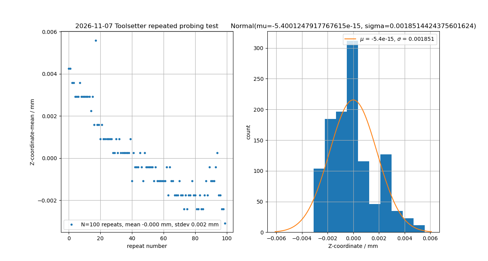

# Probing

probing with two different devices:

* Toolsetter
* Wireless 3D probe

## Toolsetter

* 2026-11-07 test with `G38.2 Z-[#<latch_dist> * 1.5] F40`, 100 repeats, results in `2026-11-07_toolsetter_test.txt`
* some thermal growth of the machine may cause a drift of ca 6 um during this test?

